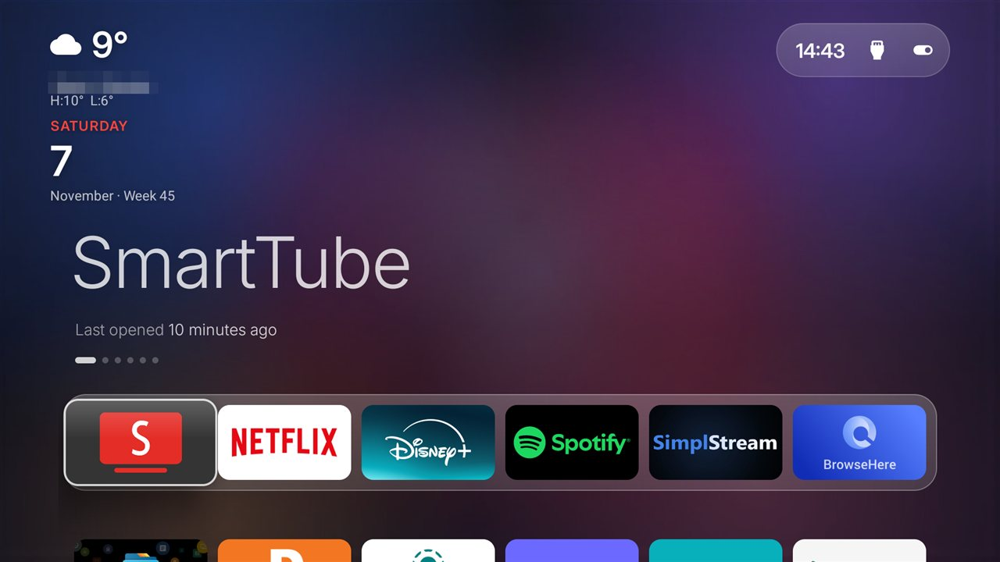
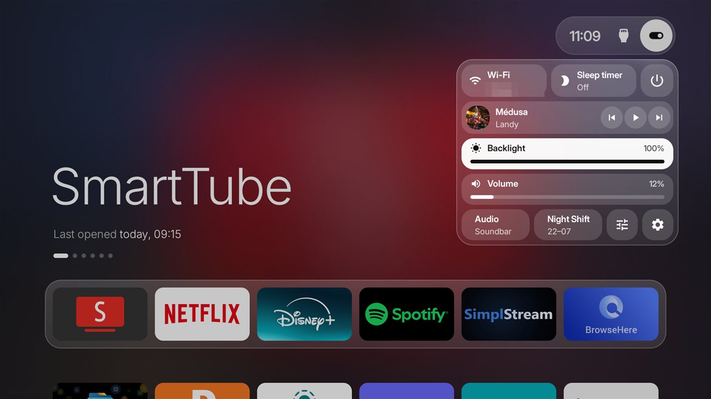
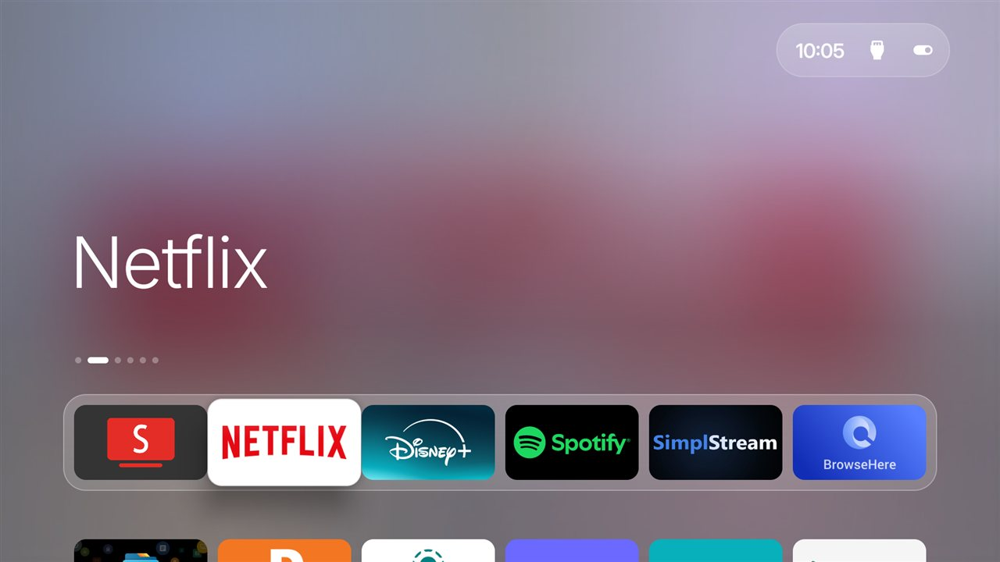
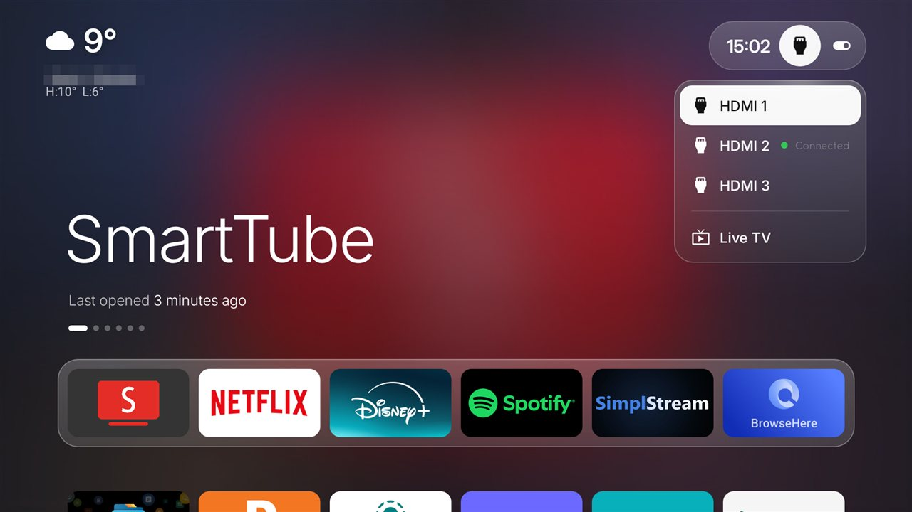
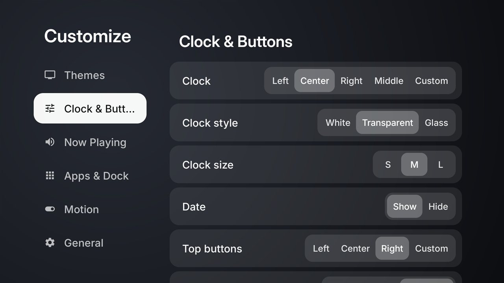

# CleanYourTV · Apple TV edition

Turn an Android TV or Google TV into an **Apple TV-style home screen**: strip the bloatware over Wi-Fi and replace
the ad-filled launcher with a clean one that looks and feels like tvOS. No root, nothing uninstalled, one-line
restore.

This is a version of [CleanYourTV](https://github.com/Gathin23/cleanyourtv) by Gathin, with an Apple TV theme and
tvOS-style features built on top. Made and tested on a **Xiaomi TV A Pro (Google TV, Android 14)**; most of it works
on any Android TV.

## Screenshots

Taken on a Xiaomi TV A Pro running this launcher.

| | |
|---|---|
|  |  |
| **Home** – Apple TV theme, top shelf, weather and date widgets | **Control Center** – drops down from the capsule |
|  |  |
| **tvOS focus** – the focused app lifts with a glass glint | **Inputs** – HDMI and Live TV in the same glass |



**Customize** – grouped like tvOS Settings.

## What you get

- **Apple TV theme** – top shelf with the focused app's artwork, a white frosted dock, a soft backdrop, and one
  glass capsule top right with the time, Inputs and Control Center.
- **Control Center** – Wi-Fi, Sleep timer, Power, Now Playing controls, Backlight and Volume sliders, Audio output,
  Night Shift, Customize and Settings in a frosted panel. Drops down from the capsule, or opens over any app with a
  remote button.
- **Now Playing** – the album art fills the top of Home while music plays, like the tvOS top shelf.
- **Widgets** – weather and date, placeable anywhere, clean or glass.
- **tvOS focus** – bigger tiles that lift, tilt and catch a glass glint, with parallax; jiggle mode to rearrange.
- **Night Shift** – the backlight dims in the evening and comes back in the morning.
- **Dark / Light / Auto** look, and a **Customize** screen grouped like tvOS Settings.

The full list, and the fixes for the Xiaomi TV, are in [APPLE-TV.md](APPLE-TV.md).

## Install with a coding assistant (about 15 minutes)

You need a computer on the same Wi-Fi as the TV with Python 3, a JDK 17 and the Android SDK (platform and
build-tools 34), and a coding assistant such as Claude Code.

1. **On the TV:** Settings → Device Preferences → About → press OK on **Build** seven times → back → Developer
   options → turn on **USB debugging** (and Network / Wireless debugging if you see it). Keep the TV on.
2. **On your computer:** clone this repo and open the folder in your assistant:
   ```bash
   git clone https://github.com/Semihh75/Cleanyourtv-appletv
   ```
   Then paste [`PROMPT.md`](PROMPT.md) and fill in your TV model.
3. **Follow along:** accept "Allow USB debugging?" on the TV and answer the questions (which apps you use, the dock
   apps, your town for the weather).

The assistant backs up the TV, removes the bloatware, builds and installs this launcher with the Apple TV theme, and
checks every step with screenshots from the TV.

## Install by hand

With the TV reachable over ADB (`tools/tv.py` connects to it):

```bash
# Windows
powershell -ExecutionPolicy Bypass -File launcher\build-and-install.ps1 -TvHost <tv ip> -InputKeyService
# macOS / Linux
TV_HOST=<tv ip> INPUT_KEY_SERVICE=1 launcher/build-and-install.sh
```

Set your weather town first in `launcher/local.properties` (`weather.city=…`, `weather.lat=…`, `weather.lon=…`).
The remote-button mapping in `launcher/app/src/main/res/values/config.xml` (`app_keys`) is for the Xiaomi remote;
change it for yours. The debloat part is described in [docs/](docs/) and the lists per TV are in
[examples/](examples/).

## Tested TVs

The debloat lists come from the original project's contributors, one folder per model in [`examples/`](examples/).
The full list is in [examples/README.md](examples/README.md).

<!-- tv-brands:start: generated by tools/gen_tables.py from examples/*/tv.json; edit those, not this -->

| | | | | | |
|---|---|---|---|---|---|
| [TCL](https://cleanyour.tv/tvs?q=TCL) · 82 | [Sony](https://cleanyour.tv/tvs?q=Sony) · 49 | [Xiaomi](https://cleanyour.tv/tvs?q=Xiaomi) · 42 | [Philips](https://cleanyour.tv/tvs?q=Philips) · 22 | [Skyworth](https://cleanyour.tv/tvs?q=Skyworth) · 17 | [Hisense](https://cleanyour.tv/tvs?q=Hisense) · 16 |
| [SHARP](https://cleanyour.tv/tvs?q=SHARP) · 10 | [Amazon Fire TV](https://cleanyour.tv/tvs?q=Amazon%20Fire%20TV) · 9 | [Panasonic](https://cleanyour.tv/tvs?q=Panasonic) · 7 | [BenQ](https://cleanyour.tv/tvs?q=BenQ) · 6 | [Haier](https://cleanyour.tv/tvs?q=Haier) · 6 | [JVC](https://cleanyour.tv/tvs?q=JVC) · 6 |
| [Toshiba](https://cleanyour.tv/tvs?q=Toshiba) · 5 | [Acer](https://cleanyour.tv/tvs?q=Acer) · 4 | [Formovie](https://cleanyour.tv/tvs?q=Formovie) · 4 | [Nokia](https://cleanyour.tv/tvs?q=Nokia) · 4 | [OnePlus](https://cleanyour.tv/tvs?q=OnePlus) · 4 | [Thomson](https://cleanyour.tv/tvs?q=Thomson) · 4 |
| [Artel](https://cleanyour.tv/tvs?q=Artel) · 3 | [Google](https://cleanyour.tv/tvs?q=Google) · 3 | [Grundig](https://cleanyour.tv/tvs?q=Grundig) · 3 | [Motorola](https://cleanyour.tv/tvs?q=Motorola) · 3 | [Noblex](https://cleanyour.tv/tvs?q=Noblex) · 3 | [NVIDIA Shield](https://cleanyour.tv/tvs?q=NVIDIA%20Shield) · 3 |
| [onn](https://cleanyour.tv/tvs?q=onn) · 3 | [RCA](https://cleanyour.tv/tvs?q=RCA) · 3 | [Redmi](https://cleanyour.tv/tvs?q=Redmi) · 3 | [RockTek](https://cleanyour.tv/tvs?q=RockTek) · 3 | [Vu](https://cleanyour.tv/tvs?q=Vu) · 3 | [CHiQ](https://cleanyour.tv/tvs?q=CHiQ) · 2 |

<details>
<summary>+78 more brands and 14 projector brands</summary>

**EKO** 2 · **FFalcon** 2 · **Hitachi** 2 · **Insignia Fire TV** 2 · **Kalley** 2 · **Kogan** 2 · **Master-G** 2 ·
**PRISM+** 2 · **Sankey** 2 · **Sber** 2 · **Síragon** 2 · **TIM** 2 · **Vidda** 2 ·
AiPro2K · AiPro4K · AIWA · AQUA · ASUS · Beko · Bell Canada · BGH · Caxium · Cecotec · Challenger · Compac · Dcolor ·
DEXP · Dialog · Durabrand · DYON · Essentiel b · Freebox · HAAM · Hikeen · Home+ · Impex · INCLO · Jio · Karbonn ·
Kodak · Koryo · KTC · KUNFT · Liberton · Lumio · LYNCAST · Magyar Telekom · MarQ · MECOOL · MTC · Next · OK. · OPPO ·
Panavox · PEAQ · Philco · Polytron · PPTV · Prosonic · Salora · SANYO · Seleco · Smarttech · STRONG · SunWind ·
Super General · TD Systems · Tele System · Tesla · TiVo · Tornado · Turkcell · Tuvio · Verizon · VISIO · Vision ·
Vityas · X.Vision ·
Alwtniet, Anker Nebula, BYINTEK, Chihi, Epson, Gadnic, HOTACK, HY320, JMGO, Magcubic, Portronics, Stellamore, Wanbo and XGIMI projectors

</details>

<!-- tv-brands:end -->

## Restore

Nothing is uninstalled. One line puts the TV back the way it was:

```bash
TV_HOST=<tv ip> tools/restore.sh examples/<your tv>/debloat.txt                                    # Android TV
TV_HOST=<tv ip> tools/restore.sh examples/<your tv>/debloat.txt com.google.android.apps.tv.launcherx  # Google TV
```

The launcher stays installed; remove it in the TV's Settings → Apps if you want it gone.
After a firmware update, see [docs/firmware-updates.md](docs/firmware-updates.md).

## Good to know

- Disable the stock launcher only after the new one runs; the install script does this in the right order.
- On Google TV the setup wizard (`setupwraith`) can take over Home once the stock launcher is off; check
  `dumpsys wifi | grep -o 'cname=[^ ]*'` first, because disabling it can delete a Wi-Fi network saved during setup.
- When you're done, switch ADB debugging off again on the TV.
- More in [docs/TROUBLESHOOTING.md](docs/TROUBLESHOOTING.md).
- Using a coding assistant? It reads [AGENTS.md](AGENTS.md) for the rules of this repo.

## Legal and licence

An independent project, not affiliated with Apple, Google or any TV maker; brand names only say what a feature looks
like or which TV it was tested on. It uses only settings the TV offers its owner (Developer options, ADB,
`pm disable-user`); no root, no firmware, no DRM bypass. Use it on a TV you own, at your own risk.

MIT, see [`LICENSE`](LICENSE) (original work © Gathin). The Inter and Outfit typefaces are under the SIL Open Font
License (`launcher/FONT-LICENSE-*.txt`), the Fluent emoji icons under `launcher/ICONS-LICENSE-FLUENT-EMOJI.txt`.
